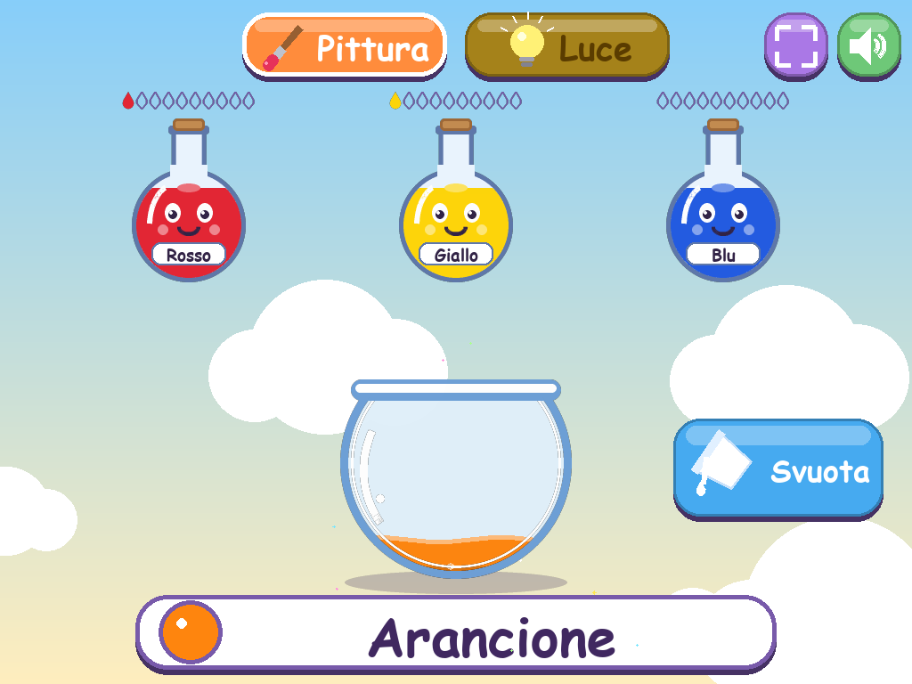
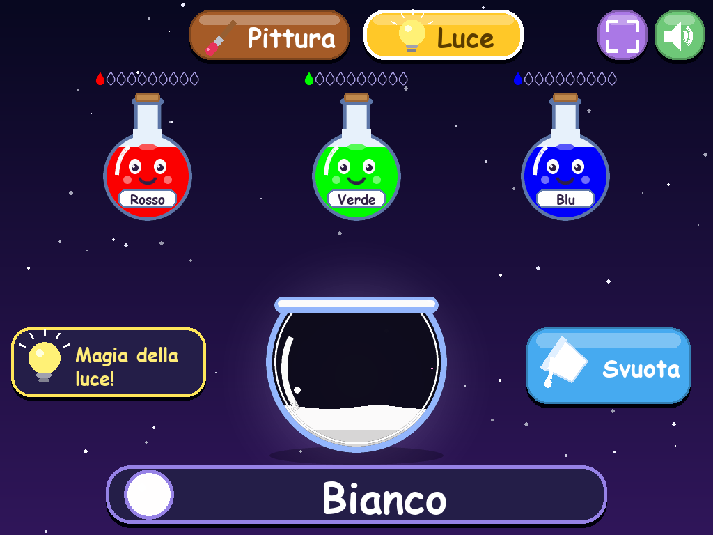

# 🧪 MixaPozioni

🇬🇧 [English version](README.md)

Gioco educativo per bambini delle elementari (6-10 anni): si mescolano pozioni
colorate in un calderone e si scopre come nascono i colori secondari.




---

## 1. Per le maestre

1. **Scaricate** il file (`MixaPozioni.exe` per Windows, `MixaPozioni-Mac.zip` per Mac).
2. **Doppio clic** per aprirlo. Non serve installare nulla.

**Windows** – se compare l'avviso blu "Windows ha protetto il PC":
clic su **"Maggiori informazioni"** → **"Esegui comunque"**. (Succede perché il programma è nuovo, non perché sia pericoloso.)

**Mac** – decomprimete lo zip, poi **tasto destro** su MixaPozioni → **Apri** → **Apri**.

**Come si gioca:** si clicca sulle pozioni per far cadere gocce nel calderone e
si legge il nome del colore ottenuto. "Svuota" per ricominciare.
"Pittura" e "Luce" cambiano il modo di mescolare. Tasto **F11** = schermo intero,
**M** = muto. **ESC** non chiude il gioco: chiede prima conferma.

---

## 2. Per lo sviluppatore

### Setup ed esecuzione
Serve Python 3.10+.

```bash
python -m venv .venv
.venv\Scripts\activate          # Windows   (Mac/Linux: source .venv/bin/activate)
pip install -r requirements-dev.txt
python main.py
```

### Test
```bash
python -m pytest -q
```
`tests/test_color_mixing.py` testa mixing e nomi colore (funzioni pure);
`tests/test_smoke.py` avvia l'intero gioco in headless (driver SDL `dummy`),
simula clic/cambio modalità/svuota/ESC/ridimensionamento. Lo stesso script
(`tools/smoke_test.py`) rigenera gli screenshot in `docs/`.

### Build dell'eseguibile
| Sistema | Comando | Risultato |
|---|---|---|
| Windows | `build_windows.bat` | `dist\MixaPozioni.exe` |
| Mac | `./build_mac.sh` | `dist/MixaPozioni.app` |
| Linux | `./build_linux.sh` | `dist/MixaPozioni` |

Gli script creano un venv, installano le dipendenze e lanciano PyInstaller
(`--onefile --windowed`, su Mac `--onedir --windowed`, vedi sotto).

### Ottenere l'.exe senza una macchina Windows (GitHub Actions)
1. Caricate il progetto su un repository GitHub e fate push su `main`
   (oppure *Actions → Build MixaPozioni → Run workflow*).
2. Il workflow `.github/workflows/build.yml` esegue i test e compila su
   Windows, macOS e Linux.
3. A fine esecuzione, nella pagina del run, sezione **Artifacts**, scaricate
   `MixaPozioni-Windows` (contiene l'`.exe`), `MixaPozioni-Mac`, `MixaPozioni-Linux`.

### Struttura
```
main.py                 entry point (DPI awareness, log errori su file)
game/constants.py       layout, temi, resource_path() per PyInstaller (sys._MEIPASS)
game/color_mixing.py    mixing Pittura (RYB) e Luce (RGB), funzioni pure
game/color_names.py     nomi italiani (tabelle separate per modalità)
game/entities.py        pozioni, calderone, gocce, particelle, contatori
game/ui.py              font, icone disegnate, pulsanti, selettore modalità
game/audio.py           suoni sintetizzati con numpy + fallback senza audio
game/game.py            loop, stati, scaling, eventi
```

### Scelte tecniche
- **Pittura = modello RYB con interpolazione trilineare.** I 3 primari (R, Y, B) sono
  coordinate nel cubo RYB; gli 8 vertici sono mappati su colori RGB scelti a mano
  (derivati dal cubo di Gosset-Chen ma più vivaci: il blu "alla Gosset" è troppo spento
  per dei bambini). Le dosi vengono **normalizzate dividendo per la più grande**, così
  1R+1Y e 4R+4Y danno lo stesso arancione saturo (senza normalizzare si mescolerebbe
  bianco e il colore risulterebbe slavato). R+Y+B in parti uguali dà il marrone.
  Una miscela sottrattiva "fisica" (Kubelka-Munk) è stata scartata: con primari RYB
  scolastici produce verdi e viola poco riconoscibili.
- **Luce = somma additiva RGB** con le stesse proporzioni normalizzate; parti uguali
  di R, G, B danno bianco. Sfondo scuro, calderone scuro e alone luminoso.
- **Nomi colore**: nome più vicino in spazio CIE Lab, tra 12 nomi (Pittura) e 13 (Luce:
  include Bianco, Magenta, Ciano, Giallo). Nomi "difficili" evitati.
- **Dosi massime = 10**, contate anche quelle ancora in caduta; oltre, l'ampolla
  trema e compare il fumetto "Pieno!" (nessun errore o suono brutto).
- **Cambio modalità** svuota il calderone all'istante; **"Svuota"** fa un'animazione
  (calderone inclinato che versa).
- **Scaling**: superficie logica fissa 1024×768 scalata alla finestra con bande nere.
  Se lo schermo è piccolo la finestra iniziale si riduce mantenendo le proporzioni.
- **Schermo intero**: F11 o F o il pulsante in alto; **ESC** esce dal pieno schermo,
  in finestra chiede conferma ("Vuoi uscire?"). La X della finestra chiude subito.
- **Font**: primo disponibile tra Comic Sans, Trebuchet, Verdana, Segoe UI, DejaVu,
  Arial; altrimenti il font incluso in pygame. Nessun font viene distribuito.
- **Grafica/audio**: zero asset esterni. Le parti statiche (ampolle, calderone, sfondi)
  sono precalcolate con supersampling; le particelle rimpiccioliscono invece di usare
  alpha per tenere i 60 FPS anche su PC vecchi. I suoni sono sintetizzati con numpy;
  senza scheda audio il gioco parte comunque muto.
- **Touch**: i touchscreen generano eventi mouse (comportamento SDL di default),
  quindi non serve codice dedicato. Aree di clic maggiorate di 22 px sulle pozioni.
- **macOS**: PyInstaller sconsiglia `--onefile` con `--windowed` (deprecato), quindi
  si usa `--onedir --windowed`, che produce comunque una singola `.app`. Non essendo
  firmata, serve "tasto destro → Apri" al primo avvio.
- **Errori**: se il gioco si blocca all'avvio scrive `MixaPozioni_errore.txt` nella
  cartella utente (con `--windowed` non c'è console).
- Il jingle e le scintille partono quando, dopo una miscela di almeno 2 primari, il
  nome del colore cambia.
